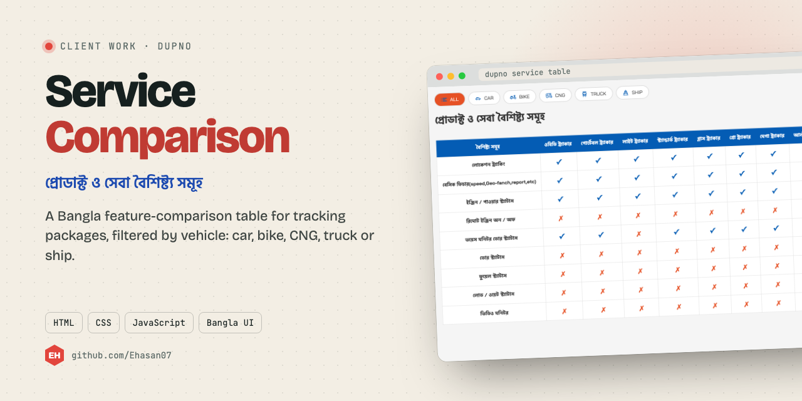
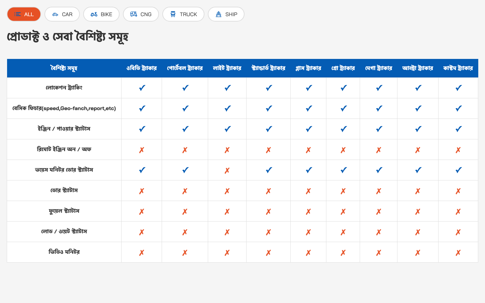

<p align="center"></p>

<p align="center"><a href="#screenshot">Screenshot</a> · <a href="#run-it">Run it</a></p>

## About

A Bangla comparison table of DUPNO's tracking packages: which features each package has, filtered by vehicle type.

## What it does

- Filter buttons: all, car, bike, CNG, truck, ship
- Ticks and crosses for every feature in every package
- Bangla labels throughout (প্রোডাক্ট ও সেবা বৈশিষ্ট্য সমূহ)

## Screenshot

<p align="center"></p>

## Built with

HTML · CSS · vanilla JavaScript

## Run it

No build step. Open `Index.html` in a browser, or serve the folder:

```bash
npx serve .
```

---

<p align="center"><sub>Made by <a href="https://github.com/Ehasan07">S M Ehasanul Haque</a> · Dhaka, Bangladesh · <a href="https://ehasanlive.com">ehasanlive.com</a></sub></p>
